# WEBPATHMINE — Complete UI Page & Navigation Audit (READ-ONLY)

**Document:** Comprehensive UI / UX Architectural Audit  
**Auditor:** Senior Streamlit Application Architect & Data Mining Engineer  
**Audit Scope:** Read-Only Codebase Inspection (`app.py`, `pages/`, `src/visualization.py`)  
**Target File:** `WEBPATHMINE_UI_PAGE_AUDIT.md`  
**Date:** October 27, 2026  
**Status:** Read-Only Inspection Complete. **Zero project files modified.**  

---

## 1. Executive Summary

### 1.1 Root Cause of UI Crowding & Claustrophobia
The technical audit confirms why the application currently feels overcrowded and fragmented:
1. **Parallel Competing Architecture (Monolith vs. Deep-Dive Pages):**  
   The application effectively contains **two independent applications inside one repository**:
   - `pages/0_⚡_Automated_Workflow.py` is a monolithic 638-line single-page dashboard containing upload controls, 5 sample dataset buttons, an interactive timeline, prediction verdict cards, a master verdict table with radio filters, prediction distribution pie charts, a confusion matrix, K-Means PCA and size charts, an expander for cluster profiles, FP-Growth support/confidence sliders, frequent itemset tables, association rule tables, rule scatter plots, top rule bar charts, raw event tables, derived session tables, 2 CRO cards, and 5 separate download buttons.
   - Simultaneously, `pages/1_📊_Data_Explorer.py` through `pages/5_💡_Model_Insights.py` provide individual deep-dive pages for the exact same steps.
2. **Redundant Dataset Ingestion Across 6 Different Pages:**  
   Dataset loaders and built-in sample switchers appear in `app.py`, Page 0, Page 1, Page 2, Page 3, and Page 4. A user is constantly prompted to upload or switch datasets across almost every page.
3. **Repetitive Explanatory Banners & Educational Cards:**  
   Every single page renders a massive HTML hero banner (`render_hero()`) taking up 180–220px of vertical space, followed by 1 to 2 explanatory callout cards (`navy-card`) with dense paragraphs before any interactive controls or data tables appear.
4. **Vertical Overload & Visual Claustrophobia:**  
   On desktop monitors, users must scroll through multiple screen heights of stacked cards, sliders, metric blocks, multi-tab containers, and large tables just to accomplish a single exploratory goal.
5. **Form Input Overload (Page 4):**  
   Page 4's single-session simulator dynamically generates 15+ individual form input widgets (`st.number_input`, `st.selectbox`) across 3 tight columns, making live inference look like an overwhelming administrative form.

---

## 2. Complete Inventory of Application Pages

The application has **7 total accessible page endpoints** in Streamlit's sidebar navigation:

| # | Filename | Sidebar Title | Main Headline / Hero | Lines of Code | Primary Role |
|---|---|---|---|---|---|
| **0** | `app.py` | `app` | `WEBPATHMINE: Web Usage & Navigation Pattern Mining` | 233 | Executive landing page, macro KPI overview, conceptual Sankey diagram. |
| **1** | `pages/0_⚡_Automated_Workflow.py` | `0 ⚡ Automated Workflow` | `INSTANT PURCHASE VERDICT & AUTOMATED MINING` | 638 | Monolithic all-in-one automated pipeline, verdict inspector, multi-module summary. |
| **2** | `pages/1_📊_Data_Explorer.py` | `1 📊 Data Explorer` | `DATA EXPLORER` | 297 | Dataset ingestion, provenance validation, missing/duplicate audit, data cleaning, export. |
| **3** | `pages/2_🕸️_Pattern_Mining.py` | `2 🕸️ Pattern Mining` | `PATTERN MINING` | 299 | FP-Growth frequent itemsets, association rules, scatter/bar plots, Markov sequence transition matrix. |
| **4** | `pages/3_👥_Behavior_Segmentation.py` | `3 👥 Behavior Segmentation` | `BEHAVIORAL SEGMENTATION` | 324 | K-Means clustering, PCA cluster space, radar profiles, silhouette diagnostics, Behavioural Ranking (0–100). |
| **5** | `pages/4_🎯_Purchase_Prediction.py` | `4 🎯 Purchase Prediction` | `PURCHASE INTENT PREDICTION` | 318 | Decision Tree classifier, 5-fold CV metrics, confusion matrix, feature importance, live simulator form. |
| **6** | `pages/5_💡_Model_Insights.py` | `5 💡 Model Insights` | `MODEL INSIGHTS` | 284 | Dynamic cross-module synthesis: top rules, cluster traits, prediction splitters, ranking overview, CRO cards. |

---

## 3. Detailed Page-by-Page Technical Audit

### 3.1 Landing Page — `app.py`
- **Exact Name in UI:** `WEBPATHMINE | Overview` (sidebar displays `app`).
- **Main Purpose:** Serves as the landing hub, introduces the project scope, displays session summary KPIs, illustrates a conceptual navigation journey, and links to sub-modules.
- **Features:**
  1. Active dataset telemetry sidebar card (Rows, Columns, Type, Conversion Rate).
  2. Quick Dataset Switcher buttons ("Shoppers Data", "Clickstream Log").
  3. High-level KPI metric cards: Total Sessions Analyzed, Purchases (Conversion), Attributes/Features, Completeness %.
  4. Conceptual E-Commerce Navigation Sankey diagram (`plot_navigation_sankey()`).
  5. Banner promoting the Automated Workflow with an internal anchor link.
  6. 4 static summary cards describing Modules 1 to 4.
- **Inputs & Controls:**
  - Sidebar buttons: "Shoppers Data", "Clickstream Log".
  - Link button: "➔ Launch Automated Workflow Dashboard".
- **Outputs:**
  - 4 high-level KPI metrics.
  - 1 Plotly Sankey diagram (macro conceptual flow).
- **Dependencies:**
  - Session state: `df`, `df_source_name`, `dataset_type`, `clickstream_df`.
  - Modules: `src/preprocessing.py` (`inspect_dataset`, `detect_dataset_type`), `src/visualization.py` (`plot_navigation_sankey`).
- **Unique Value:** Provides the only macro conceptual visual flow (Sankey) and high-level architectural framing.
- **Overlap:**
  - The dataset switcher duplicates the controls on Page 1 and Page 0.
  - The summary KPI cards duplicate the first section of Page 1.
  - The module cards duplicate what is already visible in Streamlit's sidebar navigation.
- **Usage & Importance:** **Useful but Optional as a standalone page.** In Streamlit, users often prefer landing directly into the working data explorer or analysis workspace rather than a brochure page.
- **Complexity & Clutter:** Moderate. It does not have heavy data tables, but it takes up an entire navigation slot just to display 4 KPIs, a static Sankey diagram, and text links.

---

### 3.2 Page 0 — `pages/0_⚡_Automated_Workflow.py`
- **Exact Name in UI:** `0 ⚡ Automated Workflow` (Page title: `Instant Purchase Verdict | WEBPATHMINE`).
- **Main Purpose:** Provides a "one-stop shop" where a user uploads a dataset and gets all outputs (purchase verdict, timeline, clusters, rules, predictions, and reports) on a single scrolling page.
- **Features:**
  1. Ingestion: Drag-and-drop file uploader + 5 quick-load sample buttons.
  2. Background execution: Runs session feature engineering, K-Means assignment, Decision Tree prediction, and FP-Growth simultaneously.
  3. Verdict Presentation: Glowing conversion verdict card (`render_purchase_verdict_card`).
  4. Verdict Master Table: Filterable session list (All / Purchases / No Purchases).
  5. Individual Shopper Verdict Inspector: Dropdown to view individual session confidence gauge and driver chips.
  6. Cluster Analysis: 3 metric cards, PCA 2D plot, Cluster Size donut chart, and expandable cluster profile table.
  7. Pattern Mining: 2 parameter sliders (Min Support, Min Confidence), 3 telemetry cards, and 3 sub-tabs (Frequent Itemsets, Association Rules, Visualizations).
  8. Chronological Activity Timeline: Scatter plot (`plot_session_timeline`) for top 8 sessions.
  9. Raw vs. Derived Event Tables: 2 tabs displaying raw clickstream events and 23 aggregated session metrics.
  10. Strategic CRO Insights: 2 narrative recommendation cards.
  11. Export Suite: 5 one-click download buttons (Predictions CSV, Processed Events CSV, Itemsets CSV, Rules CSV, Executive Markdown Report).
- **Inputs & Controls:**
  - 1 file uploader.
  - 5 quick-load sample dataset buttons.
  - 1 session inspector dropdown.
  - 1 radio button filter for verdicts (Show All / Purchases / Non-Purchases).
  - 2 sliders for FP-Growth (Min Support, Min Confidence).
  - 5 download buttons.
- **Outputs:**
  - 7 KPI metric cards across 3 sections.
  - 1 glowing HTML verdict card with confidence progress bar and driver chips.
  - 1 master dataframe with formatted tags.
  - 6 Plotly charts (Prediction Donut, Confusion Matrix, PCA Scatter, Cluster Donut, Rules Scatter, Top Rules Bar, Event Timeline).
  - 3 dataframes across sub-tabs.
  - 5 downloadable files.
- **Dependencies:**
  - Heaviest file in the application: imports from `src/preprocessing.py`, `src/feature_engineering.py`, `src/pattern_mining.py`, `src/clustering.py`, `src/prediction.py`, and `src/visualization.py`.
- **Unique Value:** Single-session verdict inspector card with confidence meter; interactive event timeline scatter plot; all-in-one executive markdown report generator.
- **Overlap:** **EXTREME (85%+ overlap).**  
  Almost every section in Page 0 is a duplicated, condensed version of Pages 1, 2, 3, 4, and 5.
- **Usage & Importance:** **Functionally impressive for demonstrations, but architecturally redundant.** It creates cognitive dissonance: users wonder whether they should use Page 0 or Pages 1–5.
- **Complexity & Clutter:** **Severe.** At 638 lines, it is visually overwhelming. The user is bombarded with dozens of charts, cards, tabs, and tables on a single infinite scroll.

---

### 3.3 Page 1 — `pages/1_📊_Data_Explorer.py`
- **Exact Name in UI:** `1 📊 Data Explorer` (Page title: `Data Explorer | WEBPATHMINE`).
- **Main Purpose:** Ingest, inspect, audit quality, validate schema/provenance, clean data safely, and export sanitized datasets.
- **Features:**
  1. File Uploader: Supports CSV and JSON.
  2. Built-in Sample Loaders: 3 buttons (Shoppers 3k, Clicks CSV, Activity JSON).
  3. Provenance & Capabilities Panel: Displays data source, real vs. synthetic status, granularity, session/timestamp flags, and 5 algorithm compatibility badges.
  4. Quality Metrics Bar: Total Records, Features, Missing Cells %, Duplicate Rows %, Detected Type.
  5. Tab 1 (Data Preview): Slider for row preview (5–50 rows) + Column Information table (dtypes, non-null counts, unique counts, samples).
  6. Tab 2 (Missing Values): Completeness alert + Plotly missing percentage bar chart + missing rows table.
  7. Tab 3 (Duplicates & Cleaning): Duplicate detection alert, checkbox to remove duplicates, missing value strategy selector (`none`, `impute`, `drop_rows`), target protection dropdown, and "Apply Cleaning Routine" execution button.
  8. Tab 4 (Descriptive Statistics): Numeric describe table, Plotly correlation heatmap, categorical describe table.
  9. Tab 5 (Export Processed CSV): Summary caption + "Download Cleaned CSV" button.
- **Inputs & Controls:**
  - 1 file uploader.
  - 3 built-in dataset buttons.
  - 1 preview row slider.
  - 1 duplicate removal checkbox.
  - 1 missing strategy dropdown.
  - 1 target column protection dropdown.
  - 1 cleaning execution button.
  - 1 download button.
- **Outputs:**
  - 2 provenance/capability cards with 5 colored badges.
  - 5 top KPI metric cards.
  - 2 Plotly charts (Missing Value Bar, Correlation Heatmap).
  - 5 dataframes across tabs.
  - 1 downloadable CSV.
- **Dependencies:**
  - `src/preprocessing.py` (`load_dataset`, `inspect_dataset`, `detect_dataset_type`, `validate_dataset_capabilities`, `clean_dataset`).
- **Unique Value:** The only place where the user can inspect data quality, see algorithm compatibility badges, safely impute/clean missing values, and view the correlation heatmap.
- **Overlap:** Ingestion controls duplicate `app.py` and Page 0. The preview table duplicates Page 0's data audit section.
- **Usage & Importance:** **ESSENTIAL.** A core data mining phase (CRISP-DM Data Understanding & Data Preparation).
- **Complexity & Clutter:** Moderate. The tab structure is clean, but the top section (uploader + built-in buttons + provenance card + capability card + 5 KPI cards) occupies significant vertical screen space before reaching the tabs.

---

### 3.4 Page 2 — `pages/2_🕸️_Pattern_Mining.py`
- **Exact Name in UI:** `2 🕸️ Pattern Mining` (Page title: `Pattern Mining | WEBPATHMINE`).
- **Main Purpose:** Execute FP-Growth frequent itemset discovery, generate association rules, analyze support/confidence/lift, and inspect first-order Markov sequence transition matrices.
- **Features:**
  1. Educational Concept Banner: Explains the theoretical distinction between unordered itemset co-occurrence and chronological sequence transitions.
  2. Transaction Mode Selector: Radio button to switch between Clickstream Page Views and Shopper Behavioral Features.
  3. Parameter Tuning Bar: 4 columns with Min Support slider, Metric selectbox (`confidence`, `lift`, `support`), Min Metric Threshold slider, and Max Itemset Length selectbox.
  4. Telemetry Bar: 4 metrics (Total Sessions, Unique Items, Frequent Itemsets, FP-Growth Execution Time in ms).
  5. Tab 1 (Frequent Itemsets): Itemset dataframe with support and item count.
  6. Tab 2 (Association Rules): Caption + keyword search filter input + association rules dataframe.
  7. Tab 3 (Rule Visualizations): Plotly scatter plot (Support vs Confidence colored by Lift) + Plotly bar chart (Top Rules by Metric).
  8. Tab 4 (Sequential Flow Analysis): First-order Markov transition heatmap (`plot_transition_heatmap`) + Top direct navigation paths frequency table.
  9. Tab 5 (Export Results): Two download buttons (Frequent Itemsets CSV, Association Rules CSV).
- **Inputs & Controls:**
  - 1 radio button (Transaction Mode).
  - 2 sliders (Support, Threshold).
  - 2 selectboxes (Metric, Max Length).
  - 1 text search filter for rules.
  - 2 download buttons.
- **Outputs:**
  - 4 telemetry metric cards.
  - 3 Plotly charts (Rule Scatter, Top Rules Bar, Transition Heatmap).
  - 4 dataframes across tabs.
  - 2 downloadable CSVs.
- **Dependencies:**
  - `src/feature_engineering.py` (`clickstream_to_transactions`, `shoppers_to_transactions`, `extract_navigation_sequences`).
  - `src/pattern_mining.py` (`run_fpgrowth`, `generate_rules`, `filter_rules`).
- **Unique Value:** The only place with the **Markov Transition Probability Heatmap**, chronological common navigation path rankings, rule search filtering, and metric selection flexibility.
- **Overlap:** The FP-Growth execution, sliders, rule tables, rule scatter plot, and rule bar chart are directly duplicated in Page 0.
- **Usage & Importance:** **ESSENTIAL.** Direct implementation of the core curriculum objective (Web Usage / Association Mining).
- **Complexity & Clutter:** Well-structured via tabs, but the top educational banner and 4-column parameter control bar push the actual tables down the screen.

---

### 3.5 Page 3 — `pages/3_👥_Behavior_Segmentation.py`
- **Exact Name in UI:** `3 👥 Behavior Segmentation` (Page title: `Behavior Segmentation | WEBPATHMINE`).
- **Main Purpose:** Segment user sessions into behavioral archetypes using K-Means, validate clustering with elbow/silhouette curves, inspect PCA cluster spaces, and rank visitors via the Behavioural Engagement Score (0–100).
- **Features:**
  1. Fallback switch button if active dataset lacks numerical features.
  2. Feature Selector & Parameter Tuning: Multi-select numerical features + $k$ slider (2 to 8).
  3. KPI Telemetry Bar: Total Clustered Sessions, Active Clusters ($k$), Silhouette Score, Structure Quality badge.
  4. Tab 1 (Cluster Profiles & Traits): Quantitative feature means table + segment size table + Plotly cluster size donut chart.
  5. Tab 2 (PCA Cluster Map & Radar): 2D PCA scatter plot with variance explained + Plotly normalized radar chart.
  6. Tab 3 (Elbow & Silhouette Curves): Dual-axis elbow inertia and silhouette curve chart + diagnostic guidance callout for optimal $k$.
  7. Tab 4 (Individual Cluster Inspector): Expandable accordions per cluster showing z-score characteristics and raw mean vectors.
  8. Tab 5 (🏆 Behavioural Engagement Ranking):
     - 4 KPI metric cards (Total Ranked, Mean Score, High Intent Share %, Moderate Intent Count).
     - Formula & Weights explanation callout.
     - 3-column filter/search bar (Filter by Cluster, Filter by Intent Tier, Search by ID).
     - Sortable Leaderboard Dataframe (Rank, ID, Score, Tier, Cluster, Sub-scores, Penalty).
     - Individual Session Inspector dropdown with score breakdown metrics.
     - Download Leaderboard CSV button.
- **Inputs & Controls:**
  - 1 multiselect for features.
  - 1 slider for $k$.
  - 1 dropdown for cluster filter.
  - 1 dropdown for tier filter.
  - 1 text input for ID search.
  - 1 dropdown for individual session inspector.
  - 1 download button.
- **Outputs:**
  - 8 KPI metric cards (4 for clustering, 4 for ranking).
  - 4 Plotly charts (PCA Scatter, Donut Chart, Radar Chart, Elbow/Silhouette Curve).
  - 4 dataframes across tabs.
  - 1 downloadable CSV.
- **Dependencies:**
  - `src/clustering.py`, `src/feature_engineering.py` (`compute_behavioural_engagement_score`).
- **Unique Value:** The only place with **Silhouette/Elbow diagnostic curves**, normalized radar profiles, PCA projections, and the **Behavioural Engagement Ranking Leaderboard**.
- **Overlap:** K-Means assignment, PCA plot, size donut, and cluster traits are duplicated in Page 0.
- **Usage & Importance:** **ESSENTIAL.** Core Data Mining module (Unsupervised Segmentation and User Behavior Scoring).
- **Complexity & Clutter:** **High.** Tab 5 (Engagement Ranking) is so feature-dense that it could easily be its own dedicated view. It contains its own metrics, its own search controls, its own data table, and its own individual inspector.

---

### 3.6 Page 4 — `pages/4_🎯_Purchase_Prediction.py`
- **Exact Name in UI:** `4 🎯 Purchase Prediction` (Page title: `Purchase Prediction | WEBPATHMINE`).
- **Main Purpose:** Train, validate, evaluate, and serialize a leak-free Scikit-learn Decision Tree Pipeline for purchase intent prediction, and simulate live single-session inference.
- **Features:**
  1. Fallback switch button if dataset lacks a binary purchase target.
  2. Sidebar Hyperparameter Panel: Target Column selector, Split Criterion (`gini`/`entropy`), Max Depth selector, Min Samples Split slider, Class Weighting (`balanced`/`None`), and Test Split Size slider.
  3. Training Trigger: Button ("🚀 Train Decision Tree Pipeline") + disk artifact version check alert.
  4. Top KPI Evaluation Metrics: 5 test set metrics (Accuracy, Precision, Recall, F1, ROC-AUC) + 4 Stratified 5-Fold Cross-Validation metrics sub-row.
  5. Class Imbalance Educational Card: Explains imbalance ratio and why recall/precision govern conversion modeling.
  6. Tab 1 (Confusion Matrix & Tree Architecture): Plotly confusion matrix + text properties list (criterion, realized depth, leaves, samples, weighting).
  7. Tab 2 (Feature Importance): Plotly feature importance bar chart (top 12) + complete importance table.
  8. Tab 3 (Live Single-Session Prediction): Dynamic 3-column form generating input widgets for every feature in the model + "🔮 Predict Purchase Intent" submit button + verdict outcome display (Purchase vs No Purchase) + probability progress bar + statistical disclaimer.
  9. Tab 4 (Download Persisted Model): Explanation of Joblib serialization + "📥 Download Trained Model Pipeline (.joblib)" button.
- **Inputs & Controls:**
  - Sidebar: 4 selectboxes, 2 sliders.
  - Main area: 1 train button.
  - Tab 3 Form: **15 to 17 individual form input widgets** (`st.number_input`, `st.selectbox`).
  - Tab 3: 1 form submit button.
  - Tab 4: 1 model download button.
- **Outputs:**
  - 9 KPI metrics (5 test, 4 cross-validation).
  - 2 Plotly charts (Confusion Matrix, Feature Importance Bar).
  - 1 feature importance dataframe.
  - Form inference result card with progress bar.
  - 1 downloadable `.joblib` model file.
- **Dependencies:**
  - `src/prediction.py` (`train_and_evaluate_model`, `predict_single_session`, `save_model`, `load_model`, `is_model_stale`).
- **Unique Value:** The only place where the user can tune Decision Tree hyperparameters, inspect the Confusion Matrix, view 5-fold cross-validation metrics, interactively simulate live sessions, and download the `.joblib` model.
- **Overlap:** The confusion matrix and prediction KPIs duplicate Page 0's prediction section. Feature importances duplicate Page 5's top splitter list.
- **Usage & Importance:** **ESSENTIAL.** Core Data Mining module (Supervised Machine Learning / Conversion Classification).
- **Complexity & Clutter:** **High.** Having 6 parameters in the sidebar, 9 top KPI metrics, an educational callout, 4 tabs, and a form with 15+ input fields makes this page feel very dense and heavy.

---

### 3.7 Page 5 — `pages/5_💡_Model_Insights.py`
- **Exact Name in UI:** `5 💡 Model Insights` (Page title: `Model Insights | WEBPATHMINE`).
- **Main Purpose:** Provide an executive synthesis bridging pattern mining, clustering, engagement ranking, and supervised prediction into evidence-grounded strategic Conversion Rate Optimization (CRO) observations.
- **Features:**
  1. Section 1 (FP-Growth Association Rules): Table of top 5 rules ranked by lift + 3 plain-English interpretation cards.
  2. Section 2 (Behavioral Segments): Horizontal cards per active cluster showing size, session share, and empirical z-score characteristics.
  3. Section 3 (Purchase Prediction Drivers): Primary/secondary/tertiary feature splitters with relative impurity weights + test & 5-fold CV summary metrics + empirical takeaway callout.
  4. Section 4 (Engagement Ranking Synthesis): 4 KPI cards (Total Ranked, Mean Score, High Intent %, Moderate Intent Count) + top-5 engaged sessions preview table.
  5. Section 5 (Strategic Observations & CRO Actions): 2x2 grid of dynamic cards generated from active findings (Intent Driver, Navigation Flow shortcut, Audience Prioritization, Engagement Targeting) + scientific disclaimer callout.
- **Inputs & Controls:**
  - Read-only synthesis page. **Zero inputs or controls** (pure display).
- **Outputs:**
  - 4 engagement KPI metrics.
  - 2 dataframes (Top Rules table, Top Engaged Sessions table).
  - 7 custom HTML cards (3 cluster cards, 4 CRO observation cards).
- **Dependencies:**
  - Consumes session state populated by other pages: `rules_results`, `clustering_results`, `model_results`, `ranking_results`.
- **Unique Value:** The only page that synthesizes outputs across multiple algorithms into plain-English CRO strategic recommendations.
- **Overlap:**
  - Association rules repeat Page 2.
  - Cluster traits repeat Page 3.
  - Prediction splitters repeat Page 4.
  - Engagement preview repeats Page 3.
  - CRO cards repeat Page 0's Section 5.
- **Usage & Importance:** **Potentially Redundant / Secondary.** While academically nice as a summary dashboard, it does not perform any computation of its own. It is an executive summary of the previous 3 pages.
- **Complexity & Clutter:** Low to Moderate. It is well laid out, but because it is 100% read-only text and tables, users often skip it or find it repetitive after already inspecting Pages 2, 3, and 4.

---

## 4. Main User Workflow Analysis

### 4.1 Current Reality: Two Competing User Paths
Currently, the application presents two completely disjointed mental models to the user:

```mermaid
graph TD
    subgraph "Path A: The Monolithic Shortcut (Page 0)"
        P0["Page 0: Automated Workflow"]
        P0 -->|Upload / Load| P0_Run["Background Ingestion + Clustering + Mining + Prediction"]
        P0_Run --> P0_Scroll["Scroll through 8 sections of stacked cards, charts & tables"]
    end

    subgraph "Path B: The Multi-Page Analytical Journey (Pages 1 to 5)"
        App["Landing Page (app.py)"] --> P1["Page 1: Data Explorer"]
        P1 -->|Ingest, Audit & Clean| P2["Page 2: Pattern Mining"]
        P2 -->|Mine Rules & Transitions| P3["Page 3: Segmentation & Ranking"]
        P3 -->|Cluster & Score Sessions| P4["Page 4: Purchase Prediction"]
        P4 -->|Train Tree & Run Simulator| P5["Page 5: Model Insights"]
    end
```



### 4.2 Workflow Friction Points & Pain Points
1. **Confusion of Entry Point:**  
   When a user opens the app, should they stay on `app.py`, click Page 0 (`0_⚡_Automated_Workflow`), or go to Page 1 (`1_📊_Data_Explorer`)? All three invite the user to load datasets.
2. **Double Ingestion Work:**  
   If a user uploads a file on Page 1, they explore data there. If they then click Page 0, Page 0 has its own separate upload box and triggers its own processing run.
3. **Loss of Focus on Page 0:**  
   Page 0 attempts to do everything at once. If a user just wants to see why a shopper bought, they still have to load K-Means clusters and FP-Growth rule plots.
4. **Scattered Ranking Feature:**  
   The Behavioural Engagement Leaderboard (Stage 4) was added as Tab 5 inside Page 3 (`Behavior Segmentation`). Users looking for customer/session ranking might not expect to find it tucked into the 5th tab of a clustering page.
5. **Back-and-Forth Navigation for Model Interpretation:**  
   To understand model results, the user inspects feature importance on Page 4, then has to navigate to Page 5 to read the strategic interpretation of that same feature importance.

---

## 5. Feature Duplication and Redundancy Table

| Feature | Pages Where It Appears | Is the Duplication Useful? | Observation & Recommendation |
|---|---|---|---|
| **Dataset Upload / Built-in Sample Loaders** | `app.py`, Page 0, Page 1, Page 2, Page 3, Page 4 | **No (Harmful Redundancy)** | Users are asked to load data in 6 different places. Ingestion should happen **once** globally (in a dedicated Data Hub or persistent sidebar). |
| **Dataset Provenance & Quality Metrics** | `app.py`, Page 0, Page 1 | **No** | Rows, columns, and quality metrics are shown on `app.py`, Page 0, and Page 1. Belongs exclusively in Data Explorer. |
| **Chronological Activity Timeline** | Page 0 | **No (Isolated)** | A very valuable visual plot (`plot_session_timeline`) exists only on Page 0. It belongs naturally in Data Explorer or Pattern Mining. |
| **FP-Growth Sliders & Rule Mining** | Page 0, Page 2 | **No** | Page 0 has condensed sliders; Page 2 has full parameter tuning. Having rule discovery in both places causes confusion. |
| **Association Rule Tables & Visualizations** | Page 0, Page 2, Page 5 | **No** | Top rules are shown on Page 0, full rules on Page 2, and top rules again on Page 5. |
| **K-Means Cluster PCA Plot & Donut Chart** | Page 0, Page 3 | **No** | Exactly identical PCA scatter plots and cluster size charts are generated on both Page 0 and Page 3. |
| **Cluster Profiles & Trait Summaries** | Page 0, Page 3, Page 5 | **No** | Cluster characteristics appear in an expander on Page 0, tabs on Page 3, and cards on Page 5. |
| **Decision Tree Batch Prediction Master Table** | Page 0, Page 4 | **Partially** | Page 0 shows a master table of predicted sessions with filters; Page 4 has test set evaluation and a live form, but lacks the master batch table. |
| **Confusion Matrix** | Page 0, Page 4 | **No** | Page 0 plots the confusion matrix at the bottom; Page 4 plots it as its primary evaluation tab. |
| **Feature Importances & Split Drivers** | Page 4, Page 5 | **Partially** | Page 4 has the chart; Page 5 has the text bullets. They should be unified in the Prediction module. |
| **CRO Business Recommendations** | Page 0, Page 5 | **No** | Narrative conversion suggestions appear on Page 0 (Section 5) and Page 5 (Section 5). |
| **CSV & File Downloads** | Page 0, Page 1, Page 2, Page 3, Page 4 | **Partially** | Page 0 aggregates 5 download buttons in one row; the individual pages each have their own download button in their respective export tabs. |

---

## 6. Preliminary Action Recommendations (Keep, Merge, Simplify, Optional, Remove)

### Summary Categorization

```
┌────────────────────────────────────────────────────────────────────────┐
│                          PAGE ACTION MATRIX                            │
├────────────────────────┬─────────────┬─────────────────────────────────┤
│ PAGE                   │ ACTION      │ PRIMARY RATIONALE               │
├────────────────────────┼─────────────┼─────────────────────────────────┤
│ app.py (Landing)       │ SIMPLIFY or │ Strip brochure cards; turn into │
│                        │ MERGE       │ a clean Global Data Hub.        │
├────────────────────────┼─────────────┼─────────────────────────────────┤
│ Page 0 (Auto Workflow) │ MERGE /     │ Deconstruct monolith; move its  │
│                        │ TRANSFORM   │ valuable timeline & verdict     │
│                        │             │ inspector to dedicated pages.   │
├────────────────────────┼─────────────┼─────────────────────────────────┤
│ Page 1 (Data Explorer) │ KEEP &      │ Core CRISP-DM stage; clean top  │
│                        │ SIMPLIFY    │ cards to reduce vertical scroll.│
├────────────────────────┼─────────────┼─────────────────────────────────┤
│ Page 2 (Pattern Mining)│ KEEP        │ Core curriculum algorithm;      │
│                        │             │ excellent tab layout.           │
├────────────────────────┼─────────────┼─────────────────────────────────┤
│ Page 3 (Segmentation)  │ KEEP &      │ Core clustering; elevate Tab 5  │
│                        │ REORGANIZE  │ (Engagement Ranking) prominence.│
├────────────────────────┼─────────────┼─────────────────────────────────┤
│ Page 4 (Prediction)    │ KEEP &      │ Core prediction; clean 15+ form │
│                        │ SIMPLIFY    │ inputs into collapsible drawer. │
├────────────────────────┼─────────────┼─────────────────────────────────┤
│ Page 5 (Model Insights)│ MERGE       │ Merge into a summary tab inside │
│                        │             │ Prediction or Executive Report. │
└────────────────────────┴─────────────┴─────────────────────────────────┘
```

### Detailed Recommendations

#### 1. `app.py` — **SIMPLIFY & REPURPOSE AS UNIFIED DATA HUB**
- **Why:** Currently, `app.py` is mostly static marketing text and duplicate buttons.
- **Action:** Convert `app.py` into the **Single Global Ingestion Hub**. When users open the app, they see:
  1. A clean, minimal hero title.
  2. The single, unified file uploader (CSV / JSON) and the 3 built-in sample buttons.
  3. The active dataset capabilities panel (replacing the fragmented loaders everywhere else).
  4. The conceptual Sankey overview.
- **Benefit:** Eliminates file uploaders from Pages 2, 3, 4, and 5 entirely.

#### 2. `pages/0_⚡_Automated_Workflow.py` — **DECONSTRUCT & RE-INTEGRATE**
- **Why:** Having an all-in-one page alongside 5 individual pages creates total user confusion and extreme code duplication.
- **Action:**
  - Move the **Chronological User Activity Timeline** (`plot_session_timeline`) into **Page 1 (Data Explorer)** or **Page 2 (Pattern Mining)**.
  - Move the **Instant Purchase Verdict Card** and **Session Inspector** into **Page 4 (Purchase Prediction)** as a dedicated "Batch Inference & Inspector" tab.
  - Move the **Executive Markdown Report generator** into an export modal or final tab.
  - Remove the duplicate FP-Growth and K-Means sections from Page 0.
- **Benefit:** Removes 638 lines of redundant rendering and eliminates user confusion between "Automated" vs "Manual" pages.

#### 3. `pages/1_📊_Data_Explorer.py` — **KEEP & STREAMLINE TOP BANNER**
- **Why:** Essential data mining foundation.
- **Action:** Keep the 5 tabs. Compact the top provenance and quality badges into a single horizontal telemetry strip to eliminate the need for scrolling before seeing data tables.
- **Benefit:** Immediate visibility of data tables upon page load.

#### 4. `pages/2_🕸️_Pattern_Mining.py` — **KEEP AS CORE ENGINE**
- **Why:** Best implementation of FP-Growth and Markov transition analysis.
- **Action:** Keep. Compact the top parameter controls from 4 tall columns into a sleek filter bar or collapsible sidebar expander.
- **Benefit:** Clean, focused, academically rigorous pattern mining workspace.

#### 5. `pages/3_👥_Behavior_Segmentation.py` — **KEEP & HIGHLIGHT BEHAVIOURAL RANKING**
- **Why:** K-Means clustering and the Behavioural Engagement Leaderboard (Stage 4) are central project deliverables.
- **Action:**
  - Keep the tabs.
  - Make Tab 5 (**🏆 Behavioural Engagement Ranking**) a prominent first-class feature (e.g. Tab 1 or a clearly highlighted section).
- **Benefit:** Evaluators and teachers can immediately find the 0–100 engagement leaderboard without digging into the 5th tab.

#### 6. `pages/4_🎯_Purchase_Prediction.py` — **KEEP & SIMPLIFY FORM INPUTS**
- **Why:** Decision Tree classifier, 5-fold CV, and confusion matrix are critical ML deliverables.
- **Action:**
  - Simplify the "Live Single-Session Simulator" in Tab 3. Instead of rendering 15+ tall number inputs that stretch across the screen, provide a few key sliders (e.g., Product Pages, Browsing Duration, Exit Rate) with defaults for secondary attributes, or place the simulator in a collapsible container.
  - Integrate the **Shopper Verdict Card** from Page 0 directly into Tab 3 as the live prediction output display.
- **Benefit:** Turns an intimidating 15-input tax form into a sleek, responsive conversion simulator.

#### 7. `pages/5_💡_Model_Insights.py` — **MERGE INTO AN EXECUTIVE SYNTHESIS TAB**
- **Why:** Page 5 does no computation of its own; it repeats rules from Page 2, clusters from Page 3, and splitters from Page 4.
- **Action:** Merge its dynamic strategic CRO cards into a final tab inside **Purchase Prediction** (e.g., "Strategy & CRO Insights") or keep it as a clean, single-screen "Executive Summary" tab without duplicate rule tables.
- **Benefit:** Reduces navigation menu clutter from 7 pages down to 4 or 5 focused workspaces.

---

## 7. Proposed Simpler Navigation Structure

### Proposed Architecture: The Focused 4-Stage CRISP-DM Workspace

Instead of 7 fragmented and competing pages, the application can be cleanly organized into **4 primary stages** that mirror the standard Data Mining Lifecycle:

```
CURRENT (7 Pages — Fragmented)           PROPOSED (4 Clean Workspaces)
─────────────────────────────            ─────────────────────────────
app.py (Landing)                  ──┐
pages/0_⚡_Automated_Workflow     ──┼──>  1. 🌐 Data Hub & Quality Explorer
pages/1_📊_Data_Explorer          ──┘     (Ingest once, audit, timeline & clean)

pages/2_🕸️_Pattern_Mining         ───>  2. 🕸️ Navigation Pattern Mining
                                          (FP-Growth rules, scatter, Markov flows)

pages/3_👥_Behavior_Segmentation  ───>  3. 👥 Segmentation & Engagement Ranking
                                          (K-Means, PCA, radar & 0–100 Leaderboard)

pages/4_🎯_Purchase_Prediction    ──┐
pages/5_💡_Model_Insights         ──┴──>  4. 🎯 Intent Prediction & CRO Insights
                                          (Decision Tree, 5-fold CV, simulator, CRO)
```

### Detailed Breakdown of the 4 Proposed Workspaces:

#### Workspace 1: `1_🌐_Data_Hub_&_Explorer.py`
- **Global Ingestion:** Single place to drag-and-drop or select sample datasets.
- **Provenance & Schema:** Capabilities badges (Clustering, Mining, Prediction, Ranking).
- **Quality Audit & Safe Cleaning:** Missing values, duplicates, and imputation.
- **Event Timeline:** Incorporates the chronological scatter plot from Page 0.

#### Workspace 2: `2_🕸️_Navigation_Patterns.py`
- **Frequent Itemsets:** High-speed FP-Growth discovery.
- **Association Rules:** Support, Confidence, Lift filters, search, and scatter/bar plots.
- **Sequential Flows:** Markov transition probability matrix and common paths.

#### Workspace 3: `3_👥_Segmentation_&_Ranking.py`
- **Behavioral Clustering:** K-Means with PCA 2D projections and radar profiles.
- **Diagnostics:** Elbow and silhouette curves with optimal $k$ guidance.
- **Behavioural Engagement Ranking (0–100):** Sortable leaderboard table, cluster/tier filters, search by session ID, individual inspector, and CSV export.

#### Workspace 4: `4_🎯_Prediction_&_Insights.py`
- **Supervised Classifier:** Decision Tree pipeline with Gini/Entropy and 5-fold CV.
- **Model Evaluation:** Confusion Matrix and Feature Importances.
- **Live Simulator & Verdict Card:** Sleek inference simulator featuring the glowing verdict card from Page 0.
- **Strategic CRO Synthesis:** Dynamic evidence-grounded recommendations (formerly Page 5).
- **Executive Report:** One-click download of the complete Markdown analysis report.

---

## 8. Uncertainties Requiring Visual Inspection

During this static code audit, the following UI aspects were identified that would benefit from visual check in a running browser:
1. **Vertical Scroll on 1080p Screens:**  
   In Page 3 and Page 4, the top hero banner + introductory alert cards push the actual tabs below the fold on standard 1080p laptop displays.
2. **Form Layout in Page 4 (Live Simulator):**  
   The 3-column layout for 15+ number input fields (`min_value`, `max_value`, `step`) may wrap awkwardly depending on browser zoom levels.
3. **Table Row Heights:**  
   In Page 0 and Page 3, tables set to `height=350` or `height=280` inside tabs with sticky headers can feel constrained when viewing large session cohorts.

---

## 9. Project Modification Confirmation

- **Total source files modified during this audit:** **0**
- **Total configuration files modified:** **0**
- **Total dataset files modified or deleted:** **0**
- **Total model artifacts modified or deleted:** **0**
- **Total tests modified:** **0**

This inspection was conducted strictly in **READ-ONLY** mode. All existing code, tests, and configurations remain untouched.

---
*Report compiled and certified in read-only audit mode.*
